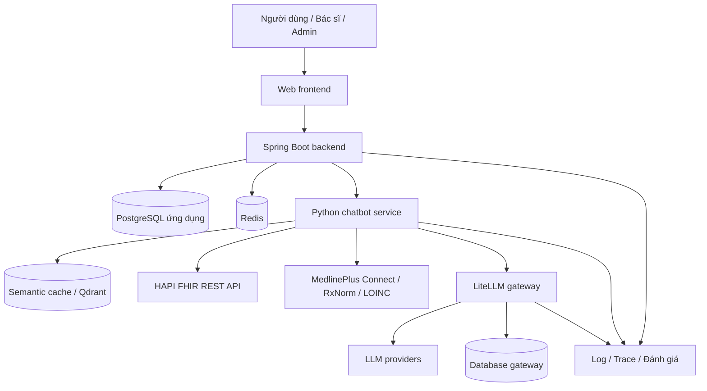

# ĐỀ CƯƠNG DỰ ÁN: HỆ THỐNG CHATBOT TRA CỨU DỮ LIỆU Y TẾ FHIR, QUẢN LÝ TÀI NGUYÊN AI VÀ GIÁM SÁT CHẤT LƯỢNG

## 1. Tổng quan dự án

### 1.1. Tên đề tài đề xuất

**Xây dựng hệ thống chatbot hỗ trợ tra cứu và giải thích dữ liệu y tế FHIR bằng tác tử AI, tích hợp quản lý tài nguyên, giám sát và đánh giá chất lượng.**

Tên ngắn: **Medical Chatbot Management & Monitoring System**.

### 1.2. Bài toán

Người dùng cần tra cứu hồ sơ bệnh nhân, lịch sử khám, chẩn đoán đã ghi nhận, thuốc và xét nghiệm bằng ngôn ngữ tự nhiên. Hệ thống phải truy xuất đúng dữ liệu, kiểm tra quyền truy cập, duy trì ngữ cảnh hội thoại và cung cấp câu trả lời có căn cứ. Đồng thời, đơn vị vận hành cần kiểm soát chi phí AI, hạn mức sử dụng, hiệu năng, lỗi và chất lượng câu trả lời.

Dự án hợp nhất ba hướng thành một sản phẩm xuyên suốt:

| Hướng ban đầu | Vai trò trong dự án thống nhất | Kết quả cần đạt |
| --- | --- | --- |
| Kiến trúc ứng dụng chatbot y tế | Xây dựng luồng hỏi đáp, agent và kết nối FHIR | Người dùng hỏi bằng tiếng Việt và nhận câu trả lời dựa trên hồ sơ được phép xem |
| Tối ưu vận hành và tài nguyên AI | Kiểm soát token, cost, quota, cache, context và routing | Đo được hiệu quả tối ưu so với cấu hình cơ sở |
| Quản trị, giám sát và audit | Quản lý người dùng, dashboard, truy vết, cảnh báo và đánh giá | Quản trị viên quan sát được hoạt động, sự cố và chất lượng hệ thống |

### 1.3. Mục tiêu

1. Xây dựng ứng dụng web hỏi đáp dữ liệu y tế có thể demo từ giao diện đến FHIR Server.
2. Dùng agent để chọn công cụ truy vấn, xử lý câu hỏi nhiều bước và tổng hợp kết quả.
3. Cung cấp giải thích thuật ngữ, thuốc và chỉ số từ các nguồn kiến thức được cấu hình.
4. Kiểm soát quyền truy cập hồ sơ bệnh nhân ở phía máy chủ.
5. Theo dõi tài nguyên theo người dùng, nhóm hạn mức, model, stage và thời gian.
6. Áp dụng cache, rút gọn ngữ cảnh và định tuyến model; đo tác động lên chi phí, độ trễ và chất lượng.
7. Cung cấp công cụ quản trị, audit, cảnh báo, sao lưu và phục hồi.
8. Đánh giá chất lượng chatbot tự động kết hợp kiểm tra thủ công trên bộ câu hỏi chuẩn.

### 1.4. Phạm vi sử dụng

- Phục vụ tra cứu hồ sơ và giải thích thông tin đã có trong dữ liệu.
- Dữ liệu demo là dữ liệu tổng hợp hoặc dữ liệu đã được khử định danh.
- Bản đầu chỉ đọc dữ liệu FHIR; không tạo đơn thuốc, sửa bệnh án hay ghi kết quả xét nghiệm.
- Chatbot không đưa ra chẩn đoán mới hoặc quyết định điều trị cá nhân hóa. Khi câu hỏi vượt phạm vi, hệ thống giải thích giới hạn và hướng người dùng đến nhân viên y tế.
- Tài liệu này mô tả phạm vi mục tiêu của dự án, không xác nhận mọi chức năng đã được triển khai trong repository hiện tại.

## 2. Người dùng và phân quyền

### 2.1. Các vai trò

| Vai trò | Chức năng chính | Phạm vi dữ liệu |
| --- | --- | --- |
| Người dùng/bệnh nhân — `USER` | Hỏi đáp, xem lịch sử, xuất chat, xem hạn mức, gửi feedback | Hồ sơ của bản thân hoặc hồ sơ được ủy quyền rõ ràng |
| Bác sĩ — `DOCTOR` | Tra cứu và tổng hợp hồ sơ của bệnh nhân phụ trách | Danh sách bệnh nhân được phân công hoặc được cấp quyền |
| Quản trị viên — `ADMIN` | Quản lý tài khoản, chính sách, cấu hình, báo cáo, sự cố và đánh giá | Dữ liệu vận hành; quyền đọc hồ sơ y tế phải được cấp riêng |

> **Phạm vi bản demo hiện tại:** `USER` chỉ xem hồ sơ đã liên kết (kiểm ở cả backend và chatbot).
> `DOCTOR` và `ADMIN` xem được mọi hồ sơ: chưa có bảng phân công bác sĩ–bệnh nhân và chưa tách
> quyền đọc bệnh án của `ADMIN`. Đây là hướng phát triển tiếp theo; giới hạn này cũng được ghi
> trong `chatbot-service/docs/agent.md` (mục Giới hạn đã biết).

### 2.2. Nguyên tắc kiểm soát truy cập

- Kiểm tra cả vai trò và quyền trên từng bệnh nhân ở mỗi truy vấn.
- Backend xác định phạm vi bệnh nhân từ tài khoản đã xác thực; không tin danh sách quyền do trình duyệt gửi lên.
- Agent chỉ được gọi công cụ nằm trong danh sách cho phép. Kết quả do LLM đề xuất vẫn phải qua kiểm tra quyền và tham số.
- Quyền quản trị hệ thống không mặc nhiên bao gồm quyền đọc toàn bộ bệnh án.
- Hội thoại, export, cache và báo cáo cá nhân phải áp dụng cùng phạm vi truy cập.
- Khi thay đổi quyền hoặc thu hồi liên kết bệnh nhân, các lần truy cập tiếp theo phải dùng quyền mới, kể cả khi có cache.
- Các thao tác quản trị và truy cập dữ liệu y tế cần có audit log phù hợp.

## 3. Kiến trúc đề xuất

### 3.1. Các thành phần

| Thành phần | Trách nhiệm |
| --- | --- |
| Web frontend | Giao diện chat, quản lý hội thoại, thông tin hạn mức, feedback và màn hình quản trị |
| Spring Boot backend | Xác thực, phân quyền, quản lý người dùng và hội thoại, quota policy, báo cáo, audit và API cho frontend |
| Python chatbot service | Agent, router, planner, công cụ FHIR, tổng hợp câu trả lời, context và tích hợp nguồn kiến thức |
| LiteLLM gateway | Quản lý credential gọi model, virtual key, đo chi phí từng call, budget và fallback provider |
| HAPI FHIR Server | Cung cấp tài nguyên y tế qua FHIR REST API |
| PostgreSQL | Lưu dữ liệu ứng dụng; tách database/schema của ứng dụng, FHIR và gateway |
| Redis | Rate limit, cache có TTL, trạng thái tạm thời và hỗ trợ phối hợp khi chạy nhiều instance |
| Qdrant hoặc kho vector tương đương | Tìm câu hỏi tương đồng phục vụ semantic cache |
| Phân hệ đánh giá | Chạy bộ câu hỏi chuẩn, tính chỉ số, lưu kết quả và so sánh các phiên bản |
| Công cụ quan sát | Thu thập log, metric và trace; có thể tích hợp Langfuse khi cần quan sát chi tiết LLM |

### 3.2. Luồng kiến trúc

### 3.3. Ranh giới trách nhiệm

- Spring là nơi quản lý chính sách sản phẩm, tài khoản, quyền bệnh nhân và hạn mức theo nhóm.
- Python là nơi xử lý quy trình hỏi đáp. LLM không truy cập trực tiếp database của ứng dụng hoặc database nội bộ của FHIR Server.
- Mọi truy vấn y tế đi qua công cụ được kiểm soát và FHIR REST API; không thực thi SQL hoặc URL tùy ý do LLM sinh ra.
- LiteLLM tính cost theo từng call. Spring nhận và lưu số do gateway báo để tổng hợp báo cáo; không áp giá của answer model lên tổng token của toàn bộ lượt chat.
- Model routing theo nghiệp vụ do chatbot service quyết định; retry và fallback provider được cấu hình tập trung ở gateway để tránh nhiều tầng cùng tự thử lại.
- Truy cập nguồn kiến thức ngoài được giới hạn bằng adapter và allowlist. MCP là lựa chọn mở rộng cho giao tiếp công cụ, không bắt buộc trong bản đầu.

## 4. Luồng nghiệp vụ chính

### 4.1. Hỏi đáp dữ liệu bệnh nhân

1. Người dùng đăng nhập, chọn hoặc tạo hội thoại và gửi câu hỏi.
2. Backend kiểm tra trạng thái tài khoản, quyền bệnh nhân, rate limit và quota.
3. Backend cung cấp định danh người dùng, phạm vi được phép, ngữ cảnh và virtual key cho chatbot service qua kết nối nội bộ.
4. Hệ thống kiểm tra cache phù hợp với người dùng, bệnh nhân, quyền và độ mới dữ liệu.
5. Router xác định nhánh: truy vấn FHIR, hỏi kiến thức, hội thoại thông thường, cần làm rõ hoặc ngoài phạm vi.
6. Planner đề xuất công cụ và tham số; bộ kiểm tra xác nhận quyền, tài nguyên, khoảng thời gian, giới hạn và số bước.
7. Công cụ truy vấn FHIR Server; kết quả được chuẩn hóa và giới hạn kích thước.
8. Nếu người dùng yêu cầu giải thích, hệ thống lấy thêm kiến thức theo mã hoặc thuật ngữ phù hợp.
9. Hệ thống chọn model hoặc template theo độ phức tạp, tài nguyên còn lại và yêu cầu chất lượng.
10. Bộ sinh câu trả lời sử dụng evidence, kiểm tra tính bám dữ liệu và gắn nguồn tham chiếu.
11. Hệ thống lưu tin nhắn, usage từng call, tổng usage của lượt chat và audit; cập nhật summary khi cần.
12. Frontend hiển thị câu trả lời, nguồn dữ liệu, trạng thái kết quả và chức năng feedback.

### 4.2. Quản trị hạn mức

1. Admin tạo hoặc sửa quota policy và gán cho người dùng/nhóm người dùng.
2. Spring lưu policy, tạo yêu cầu đồng bộ budget đến LiteLLM và ghi audit.
3. Hệ thống hiển thị trạng thái đồng bộ; lỗi được retry và cảnh báo khi quá ngưỡng.
4. Spring kiểm soát số lượt/ngày, token/ngày nếu bật và rate limit; gateway kiểm tra budget ở từng LLM call.
5. Dashboard hiển thị mức sử dụng, thời điểm reset và các trường hợp bị chặn.

### 4.3. Đánh giá và cải tiến chatbot

1. Người phụ trách tạo bộ câu hỏi có dữ liệu tham chiếu và kết quả mong đợi.
2. Chạy cấu hình cơ sở và cấu hình tối ưu trên cùng bộ dữ liệu, cùng điều kiện.
3. Thu câu trả lời, tool được gọi, evidence, token, cost, latency và lỗi.
4. Tính chỉ số tự động, kiểm tra thủ công các ca quan trọng và các ca bị đánh dấu.
5. So sánh phiên bản prompt, agent, model, cache và routing trước khi chọn cấu hình triển khai.

## 5. Danh mục chức năng chi tiết

M1–M26 giữ mã của đề xuất ban đầu. M27–M28 bổ sung hai nội dung đã có trong phần định hướng nhưng chưa được tách thành module. Với các mã được ghi theo cụm trong nguồn, tài liệu quy ước: M21 tìm kiếm, M23 export, M25 thông báo; M24 phân tích và M26 backup.

### M1. Người dùng, xác thực và phân quyền

- Đăng nhập, đăng xuất, đổi mật khẩu; hỗ trợ đăng ký nếu mô hình triển khai cho phép.
- Xác thực bằng token có thời hạn; thu hồi phiên hoặc vô hiệu hóa token khi khóa tài khoản.
- Admin tạo, sửa, khóa/mở tài khoản, gán vai trò và quota policy.
- Quản lý liên kết người dùng–bệnh nhân: bản thân, người được ủy quyền, bệnh nhân bác sĩ phụ trách.
- Kiểm tra quyền ở API và lớp công cụ; thông báo lỗi rõ ràng khi bị từ chối.
- Ghi audit cho thay đổi tài khoản, vai trò và quyền hồ sơ.

### M2. Quản lý hội thoại

- Tạo hội thoại, gửi câu hỏi, nhận câu trả lời và đổi tên hội thoại.
- Gắn bệnh nhân đang được trao đổi; yêu cầu xác nhận khi câu hỏi có nhiều bệnh nhân phù hợp.
- Hỗ trợ câu hỏi nối tiếp như “thuốc đó dùng để làm gì?” dựa trên ngữ cảnh được phép.
- Hiển thị trạng thái đang xử lý, thành công, thiếu dữ liệu, cần làm rõ, bị chặn hoặc lỗi.
- Xóa hội thoại theo quyền; quy định riêng việc giữ usage và audit phục vụ vận hành.
- Dùng định danh lượt chat để hạn chế tạo bản ghi trùng khi frontend gửi lại yêu cầu.

### M3. Lịch sử tin nhắn

- Lưu nội dung user/assistant, thời điểm, hội thoại, nguồn trả lời và trạng thái.
- Xem lịch sử theo phân trang hoặc tải thêm; sắp xếp theo thời gian.
- Hiển thị nguồn FHIR và nguồn kiến thức gắn với câu trả lời khi có.
- Giữ metadata cần thiết cho truy vết như trace ID và phiên bản prompt.
- Chỉ chủ hội thoại hoặc tài khoản được cấp quyền phù hợp được đọc lịch sử.
- Hỗ trợ chính sách lưu giữ và xóa dữ liệu hội thoại.

### M4. Tra cứu dữ liệu y tế bằng ngôn ngữ tự nhiên

- Nhận diện ý định: tìm bệnh nhân, xem hồ sơ, lịch sử khám, chẩn đoán đã ghi nhận, thuốc và xét nghiệm.
- Nhận diện bệnh nhân, loại dữ liệu, mốc thời gian, từ khóa “gần nhất” và số lượng kết quả.
- Hỏi lại khi thiếu bệnh nhân, có nhiều kết quả khớp hoặc yêu cầu chưa rõ.
- Hỗ trợ câu hỏi nhiều bước, ví dụ xem lần khám gần nhất và thuốc được chỉ định trong lần khám đó.
- Phân biệt “không có dữ liệu”, “không có quyền” và “nguồn dữ liệu đang lỗi”.
- Trả lời theo hồ sơ; không suy diễn chẩn đoán mới từ kết quả xét nghiệm.

### M5. Tích hợp FHIR

- Kết nối HAPI FHIR Server qua REST API với phiên bản FHIR được chốt khi triển khai.
- Hỗ trợ tài nguyên cốt lõi: `Patient`, `Encounter`, `Condition`, `MedicationRequest` và `Observation`.
- Bổ sung `Medication`, `DiagnosticReport` hoặc tài nguyên khác khi dữ liệu và use case yêu cầu.
- Lọc theo bệnh nhân, thời gian, trạng thái, mã và giới hạn kết quả trong phạm vi server hỗ trợ.
- Xử lý Bundle, phân trang, reference, đơn vị đo, trường thiếu và lỗi nguồn dữ liệu.
- Chuẩn hóa kết quả thành evidence; giữ loại tài nguyên, ID và thời điểm cập nhật để truy vết.
- Cung cấp dữ liệu tổng hợp và kịch bản seed có thể tái tạo phục vụ demo và kiểm thử.

### M6. Agent và tích hợp LLM

- Tổ chức quy trình agent bằng LangGraph hoặc một framework tương đương đã chọn.
- Tách stage router, planner, tool execution, answer và summary để dễ kiểm soát.
- Định nghĩa tool schema có kiểu dữ liệu, giới hạn và quyền rõ ràng.
- Kiểm tra kế hoạch do LLM sinh; giới hạn số bước và thời gian xử lý.
- Gọi model qua LiteLLM và thu usage/cost từng lần gọi.
- Sinh câu trả lời tiếng Việt từ evidence; dùng template cho các kết quả tra cứu đơn giản khi phù hợp.
- Kiểm tra grounding và chuyển sang câu trả lời dựa trên template hoặc thông báo thiếu căn cứ nếu kết quả không đạt.
- Gắn phiên bản prompt, model, tool và trace ID để có thể so sánh và điều tra.

### M7. Theo dõi mức sử dụng

- Phân biệt một lượt chat với một LLM call: một lượt có thể phát sinh nhiều call.
- Lưu input/output token theo từng call, stage, model, provider, user, thời gian và trạng thái.
- Tổng hợp usage của một lượt chat từ các call liên quan.
- Theo dõi call thành công, lỗi, retry, fallback và call đã phát sinh phí trước khi cả lượt bị lỗi.
- Hiển thị mức sử dụng cá nhân và báo cáo tổng hợp cho admin.
- Dùng call ID để chống ghi trùng khi xử lý lại dữ liệu hoặc reconcile với gateway.

### M8. Quản lý chi phí AI và gateway

- Quản lý virtual key theo người dùng ở phía máy chủ; không đưa provider key hoặc master key ra frontend.
- Lấy cost từng call từ LiteLLM; Spring lưu và tổng hợp số gateway báo.
- Phân biệt cost bằng 0 với cost chưa xác định; lưu nguồn cost và trạng thái dữ liệu đầy đủ/chưa đầy đủ.
- Cộng tổng cost theo lượt chat, user, policy, model, provider, stage và thời gian.
- Đối chiếu spend log của gateway để bổ sung các call bị mất do lỗi giữa chừng hoặc timeout.
- Tách actual spend do gateway ghi nhận, estimated cost khi thiếu dữ liệu và estimated saved cost của cache.
- Giữ bảng giá ước tính khi cần dự báo/saved cost; không dùng bảng này tính lại actual spend đa-model.
- Pin version gateway, kiểm tra contract cost header và đồng bộ budget có retry.
- Production phải từ chối gọi LLM khi thiếu virtual key hợp lệ; chế độ demo không gateway được cấu hình riêng.

### M9. Quản lý quota

- Tạo policy theo nhóm, ví dụ free, pro và enterprise; gán policy cho từng user.
- Cấu hình số lượt chat/ngày, budget cost và giới hạn token/ngày nếu cần.
- Hiển thị số đã dùng, số còn lại, thời điểm reset và nguyên nhân bị chặn.
- Đồng bộ budget từ Spring sang LiteLLM, có trạng thái và cơ chế phát hiện sai lệch.
- Chốt timezone dùng cho hạn mức ngày và kiểm thử cơ chế reset với version gateway đã pin.
- Thông báo sắp hết quota và chặn khi đạt ngưỡng theo chính sách.
- Xử lý request song song bằng cơ chế cấp giữ chỗ hoặc cập nhật nguyên tử để tránh nhiều request cùng vượt kiểm tra ban đầu.
- Nhóm policy là nhóm áp dụng cùng mức hạn ngạch; budget dùng chung cả tổ chức là chức năng mở rộng, cần cấu hình riêng.

### M10. Giới hạn tần suất — rate limiting

- Giới hạn request theo user; áp dụng ngưỡng theo IP cho các endpoint phù hợp như đăng nhập.
- Cấu hình mức giới hạn theo policy hoặc nhóm vai trò.
- Dùng Redis hoặc cơ chế tương đương để thống nhất bộ đếm giữa các instance.
- Trả HTTP 429 và thông tin thời gian chờ khi phù hợp.
- Theo dõi số lần chặn và các mẫu truy cập bất thường.
- Tách rate limit API chat khỏi giới hạn TPM/RPM của provider/gateway.

### M11. Logging và xử lý lỗi

- Ghi log có cấu trúc theo thời gian, mức độ, service, trace ID và mã lỗi.
- Chuẩn hóa lỗi xác thực, quyền, quota, dữ liệu, FHIR, LLM và nguồn kiến thức ngoài.
- Trả thông báo dễ hiểu cho người dùng; giữ chi tiết kỹ thuật trong phạm vi quản trị.
- Theo dõi thời gian từng stage và phân biệt lỗi có thể retry với lỗi cần dừng.
- Che credential, hạn chế nội dung bệnh nhân trong log; cấu hình retention và quyền đọc log.
- Liên kết log Spring, Python và gateway bằng định danh xuyên suốt.

### M12. Thiết kế cơ sở dữ liệu

- Thiết kế dữ liệu user, quyền bệnh nhân, hội thoại, message, quota, usage, audit và feedback.
- Tách dữ liệu tổng hợp một lượt chat khỏi dữ liệu từng LLM call.
- Thiết kế cấu hình, cảnh báo, thông báo, đánh giá và trạng thái backup.
- Áp dụng khóa ngoại, ràng buộc, index, migration và dữ liệu seed.
- Quy định chính sách xóa, lưu giữ và bảo toàn bản ghi phục vụ báo cáo.
- Tách dữ liệu ứng dụng khỏi dữ liệu FHIR và dữ liệu nội bộ gateway.

### M13. Dashboard quản trị

- Hiển thị user hoạt động, lượt chat, LLM call, token, cost và cache hit rate.
- Biểu diễn cost/usage theo thời gian; hỗ trợ bộ lọc user, policy, model và stage.
- Hiển thị p50/p95 latency, tỷ lệ lỗi, retry và fallback.
- Theo dõi trạng thái backend, chatbot service, FHIR, gateway, Redis và vector store.
- Hiển thị cảnh báo đang mở, tình trạng budget sync và thời điểm reconcile gần nhất.
- Liên kết từ chỉ số tổng hợp đến báo cáo chi tiết hoặc trace được phép xem.

### M14. Cache và semantic cache

- Cache kết quả truy vấn FHIR với TTL phù hợp và cơ chế làm mới.
- Exact cache cho yêu cầu trùng; semantic cache cho câu hỏi gần nghĩa khi đủ điều kiện.
- Phạm vi cache bao gồm user/phạm vi quyền, bệnh nhân, intent và điều kiện truy vấn.
- Không dùng tương đồng ngữ nghĩa làm điều kiện duy nhất: phải kiểm tra bệnh nhân, thời gian, quyền, version và độ mới dữ liệu.
- Không phục vụ lại câu trả lời lỗi, chưa đủ dữ liệu hoặc không qua grounding như một cache hit hợp lệ.
- Ghi thời điểm dữ liệu trong câu trả lời; admin có thể xem thống kê, vô hiệu hóa và xóa cache theo phạm vi.
- Đo cache hit rate, latency tiết kiệm và estimated saved cost; kiểm tra riêng nguy cơ trả dữ liệu cũ/sai bệnh nhân.

### M15. Quản lý ngữ cảnh và bộ nhớ hội thoại

- Lưu bệnh nhân đang trao đổi, intent gần nhất và tài nguyên vừa xem.
- Gửi cửa sổ tin nhắn gần nhất kết hợp rolling summary thay vì toàn bộ lịch sử.
- Giới hạn token/ngữ cảnh và kích thước evidence trước khi gọi LLM.
- Giữ mốc thời gian, bệnh nhân và nguồn cần thiết khi rút gọn; không để summary mở rộng quyền truy cập.
- Khi đổi bệnh nhân hoặc phạm vi quyền, cập nhật/loại ngữ cảnh không còn phù hợp.
- Theo dõi usage/cost của summary như một stage riêng.
- Lỗi summary không làm mất câu trả lời đã có; hệ thống giữ ngữ cảnh hợp lệ trước đó.

### M16. Định tuyến model

- Phân loại câu hỏi đơn giản, phức tạp, yêu cầu giải thích hoặc yêu cầu tổng hợp nhiều tài nguyên.
- Chọn model theo khả năng, latency, budget còn lại và chính sách chất lượng.
- Dùng template hoặc model tiết kiệm cho tác vụ phù hợp; model mạnh hơn cho tổng hợp nhiều bước khi được phép.
- Tách model của router, planner, answer và summary trong cấu hình.
- Ghi lý do routing, model yêu cầu và model thực tế sau fallback.
- So sánh cost và chất lượng của routing với cấu hình dùng một model cố định.
- Không hạ ngưỡng kiểm tra quyền hoặc grounding để tiết kiệm chi phí.

### M17. Retry, fallback và khả năng phục hồi

- Retry có giới hạn và backoff đối với lỗi tạm thời như timeout hoặc provider quá tải.
- Cấu hình fallback giữa model/provider tương thích trong gateway.
- Không retry lỗi quyền, tham số không hợp lệ hoặc budget đã hết như lỗi tạm thời.
- Tránh retry chồng tầng giữa SDK, gateway và service; chốt tổng số lần thử tối đa.
- Dùng rule/template khi phù hợp với evidence đã có và cho biết trạng thái xử lý.
- Trả kết quả một phần khi chỉ một số công cụ lỗi; nêu rõ phần dữ liệu chưa lấy được.
- Giới hạn thời gian tổng, số call và số bước; theo dõi mọi attempt có thể phát sinh phí.

### M18. Audit log

- Ghi ai truy cập, thời điểm, hành động, tài nguyên/bệnh nhân liên quan và kết quả kiểm tra quyền.
- Ghi thao tác khóa user, đổi vai trò, đổi quota, cấu hình, export và thao tác backup/restore.
- Tìm theo user, bệnh nhân, khoảng thời gian, hành động và trace ID.
- Lưu ID/tham chiếu hội thoại để điều tra; chỉ lưu nội dung câu hỏi khi có mục đích và chính sách rõ ràng.
- Hạn chế quyền đọc; không cung cấp chức năng sửa/xóa audit tùy ý trong giao diện.
- Tách audit nghiệp vụ khỏi log kỹ thuật và bảo vệ tính toàn vẹn theo mức triển khai.

### M19. Cảnh báo sự cố

- Cấu hình ngưỡng cho quota, cost, tỷ lệ lỗi, latency, fallback và dịch vụ không sẵn sàng.
- Cảnh báo budget sync thất bại, cost chưa xác định kéo dài hoặc chênh lệch reconcile.
- Cảnh báo chất lượng giảm qua các đợt evaluation.
- Phân cấp thông tin, cảnh báo và nghiêm trọng; lưu nguồn và thời điểm.
- Chống lặp bằng gom nhóm, khoảng nghỉ và điều kiện phục hồi.
- Quản lý trạng thái mở, đã tiếp nhận và đã xử lý; liên kết đến trace/báo cáo liên quan.

### M20. Cấu hình hệ thống

- Quản lý model alias, tham số routing, timeout, retry, TTL, ngưỡng semantic cache và giới hạn context.
- Quản lý endpoint FHIR, nguồn kiến thức, lịch backup và ngưỡng cảnh báo.
- Kiểm tra giá trị, phân quyền thay đổi và ghi audit.
- Phân biệt cấu hình có thể áp dụng ngay với cấu hình cần restart.
- Quản lý prompt/version để có thể rollback và so sánh kết quả.
- Credential lưu bằng biến môi trường hoặc kho secret; giao diện chỉ hiển thị trạng thái/mask.
- Khóa version thành phần và tách cấu hình development, test, production.

### M21. Tìm kiếm hội thoại

- Tìm theo tên hội thoại, từ khóa nội dung và khoảng thời gian.
- Lọc theo bệnh nhân được phép xem, trạng thái hoặc loại truy vấn khi có metadata.
- Phân trang, sắp xếp theo cập nhật gần nhất và mở đúng tin nhắn khớp.
- Kết quả tìm kiếm chỉ thuộc phạm vi hội thoại người dùng được quyền truy cập.

### M22. Feedback người dùng

- Đánh giá câu trả lời hữu ích/không hữu ích hoặc theo thang điểm thống nhất.
- Chọn lý do: sai dữ liệu, thiếu thông tin, khó hiểu, thiếu nguồn hoặc lỗi kỹ thuật.
- Cho phép ghi nhận xét; gắn feedback với message và phiên bản xử lý.
- Admin lọc, tiếp nhận, phân loại và ghi trạng thái xử lý feedback.
- Dùng các ca đã được kiểm tra làm ứng viên bổ sung bộ evaluation, không tự coi feedback là đáp án chuẩn.

### M23. Xuất dữ liệu hội thoại

- Xuất một hoặc nhiều hội thoại được phép xem, kèm thời gian, vai trò và nguồn tham chiếu.
- Bản đầu hỗ trợ JSON và Markdown; CSV cho báo cáo dạng bảng, PDF là mở rộng.
- Cung cấp tùy chọn ẩn thông tin định danh khi phù hợp với mục đích xuất.
- Không xuất secret hoặc metadata nội bộ nhạy cảm.
- Kiểm tra quyền tại thời điểm export, giới hạn kích thước và ghi audit.

### M24. Phân tích nâng cao và báo cáo

- Báo cáo usage/cost theo ngày, tháng, user, policy, model, provider và stage.
- Phân tích intent và tần suất truy vấn bệnh nhân, thuốc, xét nghiệm, chẩn đoán, lần khám.
- Phân tích cache, routing, token và context để tìm nguyên nhân chi phí cao.
- Theo dõi chất lượng theo loại câu hỏi, model, prompt version và nhánh xử lý.
- So sánh các đợt thử nghiệm; đánh dấu dữ liệu cost thiếu hoặc chỉ là estimate.
- Xuất báo cáo CSV/JSON; hiển thị rõ timezone và kỳ báo cáo.

### M25. Thông báo

- Thông báo sắp hết quota, đã hết quota, tài khoản bị khóa hoặc policy thay đổi.
- Thông báo kết quả export/backup/evaluation chạy nền khi áp dụng.
- Admin nhận thông báo sự cố và cảnh báo theo vai trò được phân công.
- Có danh sách, số chưa đọc, đánh dấu đã đọc và liên kết đến nội dung liên quan.
- Chống gửi trùng; nội dung thông báo không chứa dữ liệu bệnh nhân không cần thiết.
- Kênh trong ứng dụng là bắt buộc; email hoặc kênh bên ngoài là mở rộng.

### M26. Sao lưu và phục hồi

- Sao lưu database ứng dụng theo lịch hoặc thủ công, lưu trạng thái và kết quả.
- Sao lưu dữ liệu FHIR, cấu hình gateway và dữ liệu cần thiết khác theo phạm vi vận hành đã chọn.
- Xác định cache/vector nào có thể tái tạo, dữ liệu nào phải backup và cách khôi phục index.
- Mã hóa, giới hạn quyền truy cập và cấu hình retention cho bản sao lưu.
- Hiển thị lần backup gần nhất, kích thước và lỗi; cảnh báo khi backup thất bại.
- Kiểm thử restore vào môi trường riêng, kiểm tra số lượng bản ghi và chức năng sau phục hồi.
- Restore lên môi trường đang phục vụ phải có bước xác nhận phạm vi và kế hoạch gián đoạn.

### M27. Đánh giá chất lượng chatbot

- Quản lý bộ câu hỏi chuẩn, phiên bản dữ liệu, evidence, expected intent/tool và đáp án tham chiếu.
- Chạy evaluation theo cấu hình agent/model/prompt, lưu kết quả từng câu và kết quả tổng.
- Tích hợp Ragas và/hoặc DeepEval qua adapter; chốt metric và version thư viện cho từng đợt chạy.
- Đánh giá faithfulness, relevancy, correctness và tỷ lệ khẳng định không được evidence hỗ trợ.
- Đánh giá thêm độ đúng tool/intent, đúng bệnh nhân, đúng thời gian và hành vi từ chối truy cập.
- Phân biệt kiểm tra tự động có đáp án xác định với điểm do LLM judge chấm; lưu judge model, rubric và nhận xét.
- So sánh cấu hình cơ sở với cache, context compression và model routing trên cùng bộ kiểm thử.
- Kiểm tra thủ công mẫu đại diện và toàn bộ ca vi phạm quyền; lưu chi phí evaluation riêng khỏi chi phí phục vụ chat.

### M28. Kiến thức y khoa và giải thích dữ liệu

- Dùng MedlinePlus Connect để bổ sung thông tin giải thích khi có mã/thuật ngữ phù hợp.
- Dùng RxNorm hỗ trợ chuẩn hóa và tra cứu tên/mã thuốc trong phạm vi nguồn cung cấp.
- Dùng LOINC hỗ trợ nhận diện mã và thuật ngữ xét nghiệm; đối chiếu đơn vị, khoảng tham chiếu từ chính hồ sơ khi có.
- Tách nội dung “theo hồ sơ bệnh nhân” và “kiến thức tham khảo”, kèm nguồn và thời điểm truy xuất.
- Chỉ gửi mã hoặc thuật ngữ cần thiết ra nguồn ngoài; không gửi toàn bộ hồ sơ để tra khái niệm.
- Chuẩn hóa, cache và kiểm tra kết quả; thông báo khi không có nguồn phù hợp hoặc nguồn lỗi.
- Hỗ trợ diễn giải tiếng Việt, giữ tên/mã gốc khi cần tránh nhầm thuật ngữ.
- Không mặc định mọi nguồn đều cung cấp nội dung lâm sàng đầy đủ hoặc API miễn phí; xác nhận quyền truy cập, điều kiện sử dụng và khả năng tích hợp trước khi chốt.

## 6. Các loại truy vấn phải hỗ trợ

| Loại | Ví dụ | Kết quả mong đợi |
| --- | --- | --- |
| Hồ sơ bệnh nhân | “Cho tôi xem thông tin của bệnh nhân A” | Hồ sơ trong phạm vi quyền; hỏi lại nếu tên trùng |
| Lịch sử khám | “Lần khám gần nhất của tôi là khi nào?” | Thời gian, loại lần khám và thông tin có trong Encounter |
| Chẩn đoán đã ghi nhận | “Hồ sơ đang ghi nhận những bệnh gì?” | Condition và trạng thái, không thêm chẩn đoán mới |
| Thuốc | “Tôi đang được chỉ định những thuốc nào?” | MedicationRequest, trạng thái và hướng dẫn nếu có |
| Xét nghiệm | “Kết quả đường huyết gần nhất của tôi?” | Giá trị, đơn vị, thời gian và khoảng tham chiếu nếu có |
| Theo thời gian | “Cho xem xét nghiệm trong tháng trước” | Lọc đúng khoảng thời gian theo timezone đã chọn |
| Nhiều bước | “Lần khám gần nhất được kê thuốc gì?” | Liên kết lần khám và chỉ định trong phạm vi dữ liệu hỗ trợ |
| Giải thích | “HbA1c là gì?” | Giải thích từ nguồn kiến thức phù hợp, có tham chiếu |
| Hội thoại nối tiếp | “Còn lần trước thì sao?” | Dùng đúng ngữ cảnh; hỏi lại nếu không xác định được |
| Không có dữ liệu | “Xét nghiệm X gần nhất?” khi hồ sơ không có | Thông báo không tìm thấy, không bịa kết quả |
| Ngoài quyền | User yêu cầu hồ sơ của người không được ủy quyền | Từ chối và ghi audit; không tiết lộ dữ liệu |
| Ngoài phạm vi | “Tôi nên đổi sang thuốc nào?” | Giải thích giới hạn và hướng đến nhân viên y tế |

## 7. Thiết kế dữ liệu mức khái niệm

Các bảng dưới đây là nhóm dữ liệu đề xuất. Tên vật lý có thể điều chỉnh để tương thích schema hiện có.

| Nhóm dữ liệu | Bảng/collection đề xuất | Nội dung chính |
| --- | --- | --- |
| Tài khoản | `app_users`, dữ liệu phiên/token nếu cần | Tài khoản, vai trò, trạng thái, policy và phiên xác thực |
| Quyền bệnh nhân | `app_user_patient_links` | User, FHIR patient ID, quan hệ, phạm vi và trạng thái cấp quyền |
| Hội thoại | `chat_sessions`, `chat_messages` | Chủ hội thoại, nội dung, memory, nguồn và metadata |
| Lượt chat | `usage_logs` | Turn/trace ID, user, session, trạng thái, tổng token, cost và latency |
| LLM call | `llm_call_usage` | Call ID, turn ID, stage, model/provider thực tế, tokens, cost source, attempt và status |
| Hạn mức | `quota_policies`, mapping policy–user | Request/token/cost limit, rate limit và timezone/quy tắc reset |
| Gateway | `llm_virtual_keys`, `gateway_sync_jobs` hoặc outbox | Key được bảo vệ, budget mục tiêu, trạng thái đồng bộ và retry |
| Giá ước tính | `model_pricing` nếu còn cần | Giá phục vụ estimate/forecast/saved cost và thời điểm áp dụng |
| Cache | Redis, vector collection, `cache_entries` nếu cần | Key, embedding, phạm vi quyền, patient, TTL, nguồn và version |
| Audit | `audit_logs` | Actor, action, target, thời gian, outcome và trace ID |
| Feedback | `message_feedback` | Message, người đánh giá, lý do, nhận xét và trạng thái xử lý |
| Cảnh báo/thông báo | `alerts`, `notifications` | Loại, mức độ, người nhận, trạng thái và thời gian |
| Cấu hình | `system_settings`, `prompt_versions` | Cấu hình có version và lịch sử thay đổi |
| Evaluation | `eval_datasets`, `eval_cases`, `eval_runs`, `eval_results` | Bộ test, đầu vào, reference, cấu hình, điểm và lỗi |
| Backup | `backup_jobs`, metadata bản backup | Phạm vi, vị trí, thời gian, checksum, trạng thái và kết quả restore test |

Quan hệ chính:

- Một user có nhiều session; một session có nhiều message và lượt chat.
- Một lượt chat có nhiều LLM call; một LLM call có thể có nhiều attempt được ghi nhận.
- Một policy áp dụng cho nhiều user; quyền bệnh nhân là quan hệ riêng, không suy ra từ policy.
- Feedback gắn với message; audit/trace có thể tham chiếu turn và tài nguyên FHIR.
- Một eval dataset có nhiều case; một eval run tạo nhiều result và gắn với cấu hình/version cụ thể.

Hồ sơ lâm sàng giữ ở FHIR Server. Ứng dụng lưu định danh và dữ liệu hội thoại/evidence cần thiết theo retention; tránh sao chép toàn bộ hồ sơ sang nhiều nơi.

## 8. Giao diện và nhóm API

### 8.1. Giao diện người dùng/bác sĩ

- Đăng nhập và tài khoản cá nhân.
- Danh sách hội thoại, tìm kiếm, tạo mới, đổi tên và xóa.
- Khung chat, bộ chọn bệnh nhân trong phạm vi quyền và câu hỏi làm rõ.
- Câu trả lời với nguồn, thời điểm dữ liệu và trạng thái thiếu dữ liệu/lỗi một phần.
- Lịch sử, export, feedback, hạn mức và thông báo.

### 8.2. Giao diện quản trị

- Dashboard tổng quan và trạng thái dịch vụ.
- Quản lý tài khoản, vai trò và quyền bệnh nhân.
- Quota policy, budget sync và tình trạng virtual key.
- Báo cáo usage/cost, cache, routing và chất lượng.
- Audit log, cảnh báo, lỗi và truy vết.
- Cấu hình, prompt/version, feedback và evaluation.
- Backup, lịch sử công việc và kết quả kiểm thử restore.

### 8.3. Nhóm API đề xuất

| Nhóm | Tác vụ |
| --- | --- |
| Authentication | Đăng nhập, đăng xuất, đổi mật khẩu và quản lý phiên |
| Users / Patient permissions | Quản lý user, vai trò, policy và liên kết bệnh nhân |
| Conversations / Messages | Tạo, đọc, sửa tên, xóa, gửi câu hỏi, tìm kiếm và export |
| Patient data | Tra cứu dữ liệu trong phạm vi quyền qua backend/công cụ kiểm soát |
| Usage / Quota / Cost | Xem cá nhân, báo cáo quản trị và quản lý policy |
| Feedback / Notifications | Gửi feedback, xem và xử lý thông báo |
| Admin / Operations | Dashboard, audit, alert, settings, cache và backup |
| Evaluation | Quản lý dataset, khởi chạy, xem kết quả và so sánh run |
| Internal service APIs | Gọi agent, nhận usage, đồng bộ/reconcile gateway; chỉ truy cập nội bộ |

## 9. Yêu cầu phi chức năng

### 9.1. Bảo vệ dữ liệu và truy cập

- Mã hóa đường truyền; bảo vệ credential và key lưu trữ.
- Không lưu prompt/response chứa dữ liệu bệnh nhân trong spend log hoặc tracing bên ngoài theo mặc định; kiểm tra cả cấu hình runtime và quyền thay đổi cấu hình.
- Admin UI gateway nằm sau kiểm soát truy cập và giới hạn mạng phù hợp.
- Tối thiểu hóa dữ liệu đưa vào LLM và nguồn ngoài; lựa chọn provider theo điều kiện xử lý dữ liệu đã được chấp thuận.
- Ngăn prompt injection biến nội dung user/evidence thành lệnh vượt quyền hoặc gọi tool ngoài allowlist.
- Có retention cho hội thoại, log, audit, cache và backup; test quyền cả ở nhánh cache và export.

### 9.2. Hiệu năng và độ ổn định

- Cấu hình timeout từng nguồn và thời gian tối đa cho cả lượt chat.
- Giới hạn kích thước câu hỏi, số tài nguyên, số tool step và context.
- Chạy được bằng Docker Compose với health check và cấu hình môi trường rõ ràng.
- Thu metric p50/p95 latency, throughput, lỗi và độ trễ từng stage.
- Khai báo phần cứng, mức concurrency, dataset và cấu hình model khi báo cáo benchmark.
- Khi nguồn kiến thức ngoài lỗi, truy vấn hồ sơ vẫn trả phần dữ liệu FHIR có sẵn nếu phù hợp.

### 9.3. Khả năng bảo trì và tái lập

- Version hóa code, prompt, cấu hình model, dữ liệu seed và bộ evaluation.
- Có unit test, integration test và kịch bản kiểm thử toàn luồng ở các điểm ảnh hưởng quyền, quota, cost và dữ liệu.
- Tách adapter FHIR, gateway, nguồn kiến thức và evaluation để thay thế có kiểm soát.
- Có tài liệu triển khai, biến môi trường mẫu, quy trình backup/restore và xử lý sự cố.

## 10. Đánh giá hiệu quả và tiêu chí nghiệm thu

### 10.1. Bộ dữ liệu kiểm thử

- Mục tiêu bản đầu: ít nhất 100 câu hỏi tiếng Việt đã được kiểm tra, chia theo truy vấn đơn, nhiều bước, giải thích và hội thoại nối tiếp.
- Có ca thiếu dữ liệu, tên bệnh nhân trùng, thời gian mơ hồ, đổi bệnh nhân và đổi quyền giữa hội thoại.
- Có ca ngoài quyền, prompt injection, timeout, budget hết giữa lượt và retry/fallback.
- Có câu hỏi gần nghĩa cho semantic cache và câu hỏi gần nghĩa nhưng khác bệnh nhân/thời gian để kiểm tra cache trả nhầm.
- Tách tập dùng điều chỉnh prompt/routing khỏi tập đánh giá cuối; tránh dùng toàn bộ tập test để tinh chỉnh rồi báo cáo lại.

### 10.2. Chỉ số chất lượng

| Chỉ số | Cách sử dụng |
| --- | --- |
| Intent accuracy | Tỷ lệ case chọn đúng intent so với nhãn chuẩn |
| Tool/parameter accuracy | Đúng công cụ, bệnh nhân, bộ lọc thời gian, mã và giới hạn |
| Faithfulness | Mức độ câu trả lời được evidence hỗ trợ, theo metric/rubric đã chốt |
| Relevancy | Mức độ trả lời đúng câu hỏi; ghi rõ phương pháp chấm |
| Answer correctness | So sánh với đáp án tham chiếu, dùng kiểm tra xác định và review khi phù hợp |
| Unsupported-claim rate | Số khẳng định không được nguồn hỗ trợ / tổng khẳng định được đánh giá |
| Unsafe-access count | Số case trả dữ liệu ngoài quyền; yêu cầu bằng 0 trên bộ test quyền |
| Refusal/clarification quality | Đúng hành vi khi yêu cầu ngoài phạm vi, thiếu bệnh nhân hoặc dữ liệu mơ hồ |

Không coi một điểm LLM judge là bằng chứng tuyệt đối về độ đúng y khoa. Mỗi metric cần ghi scale, rubric, model chấm, version và cách xử lý case không có đáp án. “Hallucination rate” trong báo cáo phải gắn với định nghĩa đo cụ thể, chẳng hạn unsupported-claim rate ở trên.

### 10.3. Chỉ số vận hành và tối ưu

| Chỉ số | Định nghĩa |
| --- | --- |
| Token/chat | Tổng token mọi LLM call phục vụ lượt chat, bao gồm router/planner/answer/summary |
| Cost/chat | Tổng cost gateway ghi nhận cho lượt chat; tách riêng evaluation và job nền không thuộc lượt |
| End-to-end latency | Thời gian từ backend nhận câu hỏi đến trả xong phản hồi |
| Throughput | Số lượt hoàn thành trên đơn vị thời gian tại mức concurrency công bố |
| Cache hit rate | Số lookup được phục vụ bằng cache hợp lệ / số lookup đủ điều kiện |
| Error/retry/fallback rate | Tỷ lệ theo lượt chat hoặc call, ghi rõ mẫu số |
| Cost completeness | Tỷ lệ call có cost xác định và tình trạng đối chiếu với gateway |

Thiết kế thí nghiệm:

1. Cấu hình cơ sở: model cố định, không semantic cache, không summary; vẫn giữ giới hạn context và kiểm tra quyền.
2. Bật lần lượt cache, context compression và routing để đo từng tác động.
3. Chạy cấu hình kết hợp cuối và đối chiếu chất lượng với cấu hình cơ sở.
4. Với cache, báo cáo riêng lần chạy cache rỗng và cache đã có dữ liệu.
5. Lặp lại các ca đủ để phản ánh biến động; giữ dataset, phần cứng và điều kiện concurrency nhất quán.

Các mục tiêu tối ưu như giảm token, cost hoặc p95 phải được chốt sau khi có baseline. Không cam kết một tỷ lệ phần trăm khi chưa đo; báo cáo cả các nhóm câu hỏi bị giảm chất lượng hoặc tăng latency.

### 10.4. Điều kiện nghiệm thu chức năng

- Chạy được luồng đăng nhập → hỏi → truy vấn FHIR → trả lời có nguồn → lưu lịch sử → xem báo cáo.
- Các loại truy vấn ở mục 6 có kịch bản demo và kết quả tham chiếu.
- Test quyền không lộ dữ liệu qua tool, cache, history hoặc export.
- Phân biệt request quota, provider rate limit và cost budget; kiểm thử vượt ngưỡng và reset.
- Báo cáo cost lấy từ từng call; ca lỗi giữa lượt có thể ghi nhận hoặc reconcile đầy đủ, tránh ghi trùng.
- Cấu hình thiếu virtual key không dẫn đến gọi bằng master key trong production.
- Cache và context compression có số liệu trước/sau, kèm đánh giá chất lượng.
- Dashboard, audit, alert, feedback và thông báo có thể thao tác trong demo.
- Có ít nhất một lần backup và restore thử thành công vào môi trường riêng.
- Bộ evaluation, cấu hình và báo cáo kết quả có thể chạy lại theo tài liệu.

## 11. Phạm vi triển khai theo giai đoạn

| Giai đoạn | Nội dung | Đầu ra |
| --- | --- | --- |
| 1. Nền tảng dữ liệu và quyền | M1, M5, M12; seed FHIR, Docker Compose, cấu hình cơ sở | Tài khoản, quyền bệnh nhân, database và FHIR chạy ổn định |
| 2. Hỏi đáp toàn luồng | M2, M3, M4, M6; logging và audit tối thiểu | Chat tiếng Việt có evidence và lịch sử, không truy vấn ngoài quyền |
| 3. Kiểm soát tài nguyên | M7–M10, M16–M17; virtual key, budget sync và cost từng call | Hạn mức, báo cáo cost cơ sở và hành vi khi dịch vụ lỗi |
| 4. Tối ưu và giải thích | M14–M15, M28; xây bộ test M27 từ sớm | Cache/context/routing có benchmark và giải thích có nguồn |
| 5. Quản trị hoàn chỉnh | M11, M13, M18–M26; mở rộng các phần đã có | Dashboard, cấu hình, tìm kiếm, feedback, export, alert và backup |
| 6. Đánh giá và bàn giao | Hoàn thiện M27, kiểm thử quyền/tải/sự cố và tài liệu | Báo cáo chất lượng, hiệu quả tối ưu và demo có thể tái tạo |

Logging, audit, kiểm tra quyền và dữ liệu test được thực hiện xuyên suốt; giai đoạn sau chỉ mở rộng mức độ hoàn thiện. Mục tiêu cuối bao gồm đủ M1–M28, còn từng giai đoạn tạo một bản có thể chạy và kiểm tra độc lập.

Các phần mở rộng sau khi hoàn tất chức năng cốt lõi: MCP cho công cụ, SSO, email alert, PDF export, budget dùng chung tổ chức, nhiều cơ sở y tế, streaming và nền tảng quan sát riêng. Không cần triển khai đồng thời nhiều framework agent hoặc nhiều vector database.

## 12. Phân công theo ba nhóm trong một dự án

| Nhóm | Phạm vi phụ trách chính | Điểm phối hợp |
| --- | --- | --- |
| Nhóm 1 — Ứng dụng và trải nghiệm | M1–M3, M13, M15, M21, M23, M25 | Giao diện user/admin, hội thoại và memory contract; phối hợp Nhóm 2 ở context và Nhóm 3 ở dashboard/quota |
| Nhóm 2 — Agent và dữ liệu y tế | M4–M6, M12, M16–M17, M20, M22, M28 | Agent, FHIR, nguồn kiến thức, schema và cấu hình; phối hợp Nhóm 3 về gateway/cost |
| Nhóm 3 — Tài nguyên và vận hành | M7–M11, M14, M18–M19, M24, M26, M27 | Gateway, quota, cache, log, báo cáo, backup và hạ tầng đánh giá |

Phân công này giữ bố cục ba nhóm ban đầu nhưng mọi nhóm cùng xây một hệ thống. Nhóm phụ trách chính sở hữu kết quả module, các nhóm còn lại cùng tích hợp theo contract.

Những contract cần chốt chung từ đầu:

- Định danh user, session, turn, trace, LLM call và bệnh nhân FHIR.
- Schema câu hỏi, câu trả lời, evidence, memory update và lỗi.
- Quyền bệnh nhân và hành vi khi có nhiều bệnh nhân phù hợp.
- Usage/cost từng call, trạng thái cost thiếu, timezone và kỳ quota.
- Metric evaluation, phiên bản prompt/model và bộ dữ liệu kiểm thử.
- API frontend/backend, API nội bộ và quy tắc bảo vệ secret/log.

Điểm/khối lượng của danh sách gốc được xem là ước lượng ban đầu; cần phân bổ lại sau khi tách M27–M28, cost từng call và tích hợp xuyên nhóm.

## 13. Sản phẩm bàn giao

1. Mã nguồn frontend, backend, chatbot service và cấu hình hạ tầng.
2. Tài liệu kiến trúc, luồng agent, phân quyền, thiết kế dữ liệu và API.
3. Migration, dữ liệu FHIR tổng hợp, tài khoản demo và cấu hình mẫu không chứa secret thật.
4. Bộ câu hỏi chuẩn, script evaluation, kết quả từng case và báo cáo tổng hợp.
5. Báo cáo so sánh token, cost, latency, throughput và chất lượng trước/sau tối ưu.
6. Dashboard và kịch bản demo quản trị quota, cảnh báo, audit và xử lý sự cố.
7. Hướng dẫn chạy Docker Compose, vận hành, backup/restore và khắc phục lỗi thường gặp.
8. Biên bản kiểm thử chức năng, quyền, cost, quota và restore; ghi rõ hạn chế còn lại.

## 14. Kịch bản demo tổng hợp

1. User đăng nhập và hỏi kết quả xét nghiệm gần nhất của chính mình.
2. Hệ thống truy vấn Observation, trả giá trị/đơn vị/thời gian và nguồn.
3. User hỏi nối tiếp ý nghĩa của chỉ số; hệ thống dùng đúng ngữ cảnh và thêm kiến thức tham khảo.
4. Bác sĩ đăng nhập, chọn một bệnh nhân phụ trách và hỏi lần khám gần nhất cùng thuốc được chỉ định.
5. Một tài khoản thử truy vấn bệnh nhân ngoài quyền; hệ thống từ chối và ghi audit.
6. Gửi lại câu hỏi gần nghĩa trong điều kiện cache hợp lệ để minh họa giảm latency/call.
7. Admin xem cost theo stage/model, chỉnh policy và theo dõi đồng bộ budget.
8. Mô phỏng quota hết hoặc provider lỗi để minh họa chặn, retry/fallback và cảnh báo.
9. Gửi feedback, tìm hội thoại và export lịch sử trong phạm vi quyền.
10. Xem kết quả evaluation so sánh baseline với cấu hình tối ưu và kết quả restore thử.

## 15. Mô tả đề tài rút gọn dùng trong báo cáo

Dự án xây dựng một hệ thống chatbot hỗ trợ tra cứu dữ liệu y tế FHIR bằng tiếng Việt, sử dụng tác tử AI để lựa chọn công cụ, thực hiện truy vấn có kiểm soát và tổng hợp câu trả lời dựa trên dữ liệu. Hệ thống bổ sung giải thích thuật ngữ và thông tin y khoa từ các nguồn tham khảo phù hợp, đồng thời quản lý phiên hội thoại và ngữ cảnh. Phân hệ vận hành theo dõi lượt gọi, token, chi phí và hạn mức thông qua AI gateway, áp dụng cache, rút gọn context, model routing và fallback. Phân hệ quản trị cung cấp dashboard, audit, cảnh báo, feedback, báo cáo và backup/restore. Chất lượng chatbot và hiệu quả tối ưu được đánh giá trên bộ câu hỏi chuẩn bằng các chỉ số xác định, công cụ đánh giá AI và kiểm tra thủ công, với trọng tâm là truy vấn đúng dữ liệu, đúng quyền và câu trả lời có căn cứ.
